<<<<<<< HEAD
# 244107020241-mobile-course
=======
# Laporan Praktikum Pemrograman Mobile
## Minggu 5 — Local Storage & Offline First

**Nama Proyek:** `week5_offline_notes`

---

## 1. Identitas Mahasiswa

| Keterangan | Identitas |
|---|---|
| Nama | Andy Otani Dipo Yudho |
| NIM | 244107020241 |
| Kelas | TI - 3C |
| Mata Kuliah | Praktikum Pemrograman Mobile (Flutter) |
| Pertemuan | Minggu ke-5 |
| Topik | Local Storage & Offline First |
| Repository GitHub | [Link repository] |

## 2. Deskripsi Proyek

Proyek ini merupakan aplikasi **Offline Notes** berbasis Flutter yang menerapkan penyimpanan data lokal dan pendekatan *offline-first*. Aplikasi digunakan untuk menyimpan preferensi pengguna, mengelola catatan secara persisten, menampilkan data posts dari cache, serta menjalankan sinkronisasi ketika koneksi internet tersedia.

SharedPreferences digunakan untuk menyimpan preferensi sederhana, SQLite melalui paket `sqflite` digunakan untuk menyimpan catatan, sedangkan Riverpod digunakan untuk mengelola state aplikasi.

### Tujuan Praktikum

1. Menerapkan penyimpanan preferensi menggunakan SharedPreferences.
2. Membuat model dan database SQLite untuk mengelola catatan.
3. Mengimplementasikan operasi CRUD menggunakan Riverpod.
4. Menerapkan mekanisme *cache-first* dan sinkronisasi *offline-first*.
5. Menguji aplikasi menggunakan unit test dan repository palsu.
6. Mengevaluasi serta merapikan struktur kode melalui AI Prompt Challenge dan Refactoring Challenge.

## 3. Teknologi yang Digunakan

| Teknologi/Paket | Fungsi |
|---|---|
| Flutter | Framework pengembangan aplikasi mobile |
| Dart | Bahasa pemrograman |
| `flutter_riverpod` | State management |
| `shared_preferences` | Penyimpanan preferensi pengguna |
| `sqflite` | Database SQLite lokal |
| `path` | Pengelolaan path database |
| `dio` | HTTP client untuk mengambil data posts |
| `go_router` | Pengelolaan navigasi halaman, jika digunakan pada hasil refactoring |
| `flutter_test` | Pengujian aplikasi |

## 4. Struktur Proyek

Struktur berikut mencakup file utama praktikum dan file refactoring yang dijelaskan dalam laporan. Sesuaikan daftar ini dengan file yang benar-benar tersedia di repository.

```text
week5_offline_notes/
├── lib/
│   ├── main.dart
│   ├── app_router.dart
│   ├── data/
│   │   ├── local/
│   │   │   ├── db.dart
│   │   │   └── note.dart
│   │   ├── remote/
│   │   │   └── post.dart
│   │   ├── repositories/
│   │   │   ├── note_repository.dart
│   │   │   └── post_repository.dart
│   │   ├── prefs.dart
│   │   └── sync.dart
│   ├── providers/
│   │   ├── prefs_providers.dart
│   │   ├── note_providers.dart
│   │   ├── offline_providers.dart
│   │   └── post_providers.dart
│   ├── widgets/
│   │   ├── note_form_dialog.dart
│   │   └── note_tile.dart
│   └── pages/
│       ├── settings_page.dart
│       ├── notes_page.dart
│       ├── note_detail_page.dart
│       └── posts_page.dart
├── test/
│   └── note_test.dart
├── docs/
│   ├── ai-challenge.md
│   └── perbandingan-storage.md
├── screenshots/
└── README.md
```

---

## 5. Praktikum 1 — Preferensi dengan SharedPreferences

### Hasil Screenshot Aplikasi

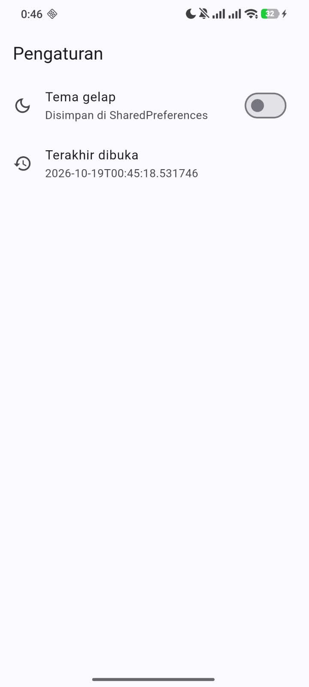

*Gambar 1. Tampilan aplikasi dengan tema terang.*

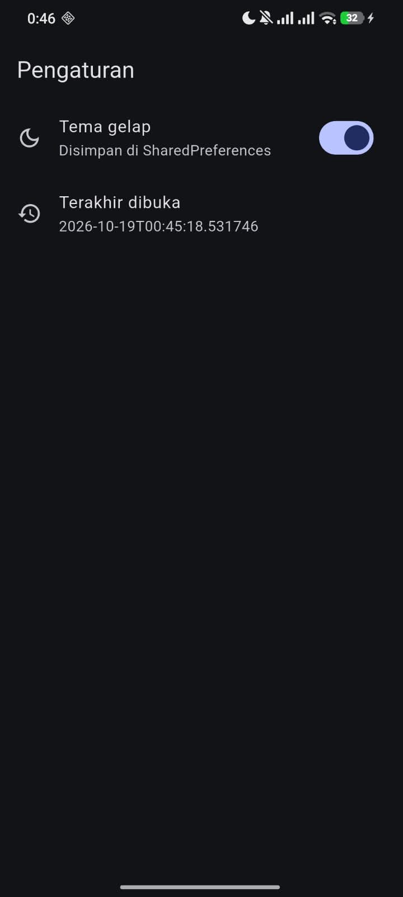

*Gambar 2. Tampilan aplikasi dengan tema gelap.*

### Pertanyaan Praktikum 1

**1. Mengapa `SharedPreferences.getInstance()` tidak boleh dipanggil di dalam method `build()` widget?**

**Jawaban:** Method `build()` dapat dipanggil berulang kali ketika tampilan diperbarui. Jika SharedPreferences dipanggil langsung di dalamnya, proses pengambilan data menjadi kurang efisien. Sebaiknya, akses data dikelola melalui repository dan provider.

**2. Jelaskan alur data dari saat switch ditekan sampai nilai tersimpan di disk dan tema berubah.**

**Jawaban:** Saat switch ditekan, method `toggle()` mengubah nilai tema melalui Riverpod. Tampilan kemudian mengikuti tema yang baru, sementara nilainya disimpan ke SharedPreferences agar tetap tersimpan meskipun aplikasi ditutup.

**3. Apa kelebihan dan risiko pendekatan optimistic update pada `toggle()`?**

**Jawaban:** Kelebihannya, perubahan tema langsung terlihat tanpa menunggu proses penyimpanan sehingga aplikasi terasa lebih responsif. Risikonya, jika penyimpanan gagal, tampilan sudah terlanjur berubah. Oleh karena itu, mekanisme *rollback* diperlukan untuk mengembalikan nilai sebelumnya.

---

## 6. Praktikum 2 — Model dan Database SQLite

### Hasil Screenshot

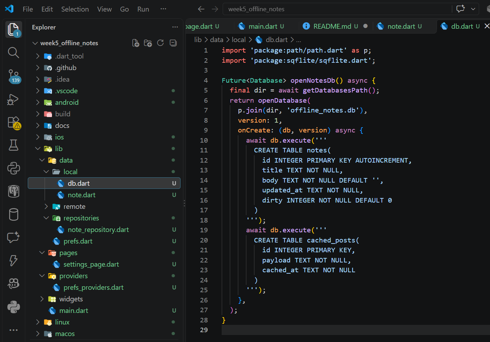

*Gambar 3. Implementasi database dan repository.*

### Pertanyaan Praktikum 2

**1. Mengapa kolom `dirty` bertipe INTEGER dan bukan BOOLEAN?**

**Jawaban:** SQLite tidak memiliki tipe data BOOLEAN secara khusus. Oleh karena itu, kolom `dirty` menggunakan INTEGER dengan nilai `1` untuk `true` (belum tersinkronisasi) dan `0` untuk `false` (sudah tersinkronisasi).

**2. Apa fungsi parameter `openDb` pada constructor `NoteRepository`?**

**Jawaban:** Parameter `openDb` memungkinkan fungsi pembuka database diganti ketika repository diuji. Dengan demikian, pengujian dapat menggunakan database sementara atau implementasi pengganti tanpa harus selalu membuka database SQLite asli.

**3. Mengapa query memakai `where: 'id = ?'` dan `whereArgs`, bukan interpolasi string?**

**Jawaban:** Penggunaan `whereArgs` memisahkan nilai parameter dari perintah SQL sehingga query lebih aman dan membantu mencegah SQL injection. Cara ini juga membuat query lebih mudah dikelola.

**4. Apa yang terjadi jika menambah kolom baru di `onCreate` tanpa menaikkan `version`?**

**Jawaban:** Kolom baru tidak otomatis ditambahkan ke database yang sudah dibuat karena `onCreate` hanya dijalankan ketika database pertama kali dibuat. Untuk memperbarui struktur database yang sudah ada, versi database perlu dinaikkan dan proses migrasi disiapkan melalui `onUpgrade`.

---

## 7. Praktikum 3 — Halaman Catatan Offline dengan Riverpod

### Hasil Screenshot

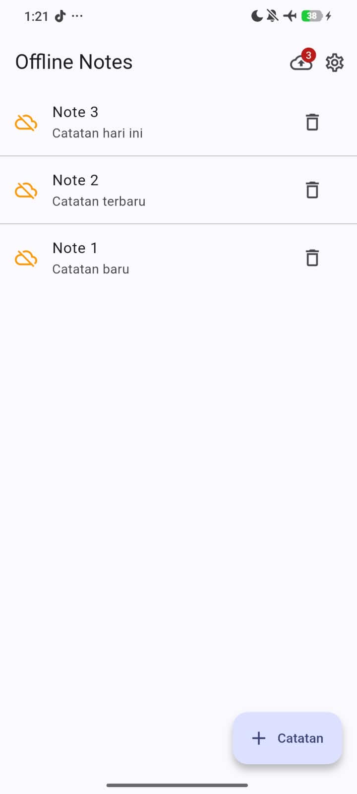

*Gambar 4. Halaman daftar catatan.*

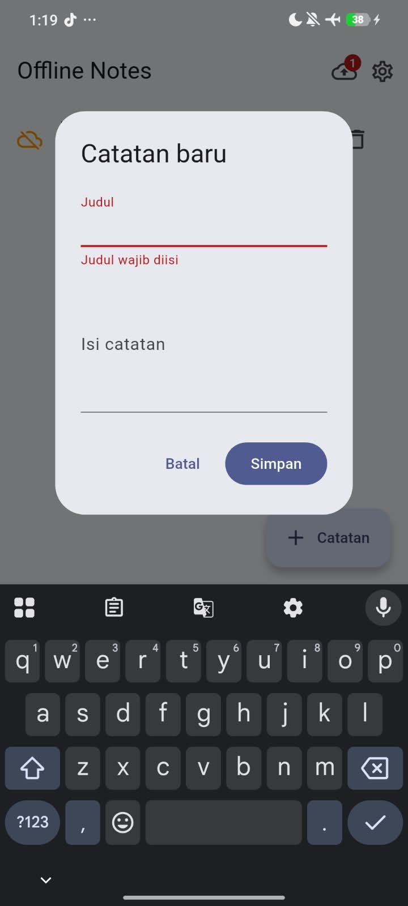

*Gambar 5. Tampilan validasi form catatan.*

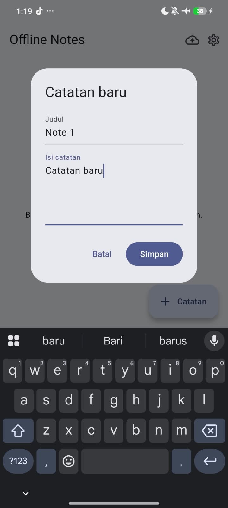

*Gambar 6. Form untuk menambah atau mengubah catatan.*

### Pertanyaan Praktikum 3

**1. Mengapa setelah setiap mutasi perlu meng-invalidate `notesProvider` dan `dirtyCountProvider`? Apa yang terjadi jika hanya salah satu?**

**Jawaban:** Kedua provider perlu di-invalidate agar daftar catatan dan jumlah catatan yang belum tersinkronisasi diperbarui setelah operasi tambah, ubah, atau hapus. Jika hanya salah satu yang di-invalidate, data pada bagian lainnya bisa tidak diperbarui sehingga tampilan aplikasi tidak sesuai dengan kondisi database terbaru.

**2. Bagaimana cara memicu state error secara sengaja untuk menguji tampilan `_ErrorView`?**

**Jawaban:** State error dapat dipicu dengan membuat `notesProvider` menghasilkan exception secara sengaja, misalnya menggunakan `throw Exception('Tes ErrorView')`. Ketika error terjadi, Riverpod akan menampilkan state error sehingga `_ErrorView` dan tombol “Coba lagi” dapat diuji. Setelah pengujian selesai, kode perlu dikembalikan seperti semula.

**3. Mengapa aplikasi tetap berfungsi dalam mode pesawat walaupun tidak ada kode khusus untuk mode offline?**

**Jawaban:** Aplikasi tetap berfungsi dalam mode pesawat karena data catatan disimpan secara lokal menggunakan SQLite. Operasi tambah, baca, ubah, dan hapus dilakukan melalui `NoteRepository` tanpa memerlukan koneksi internet. Dengan demikian, pengguna tetap dapat mengelola catatan meskipun internet tidak tersedia.

---

## 8. Praktikum 4 — Offline-First: Cache-First dan Sinkronisasi

### Hasil Screenshot

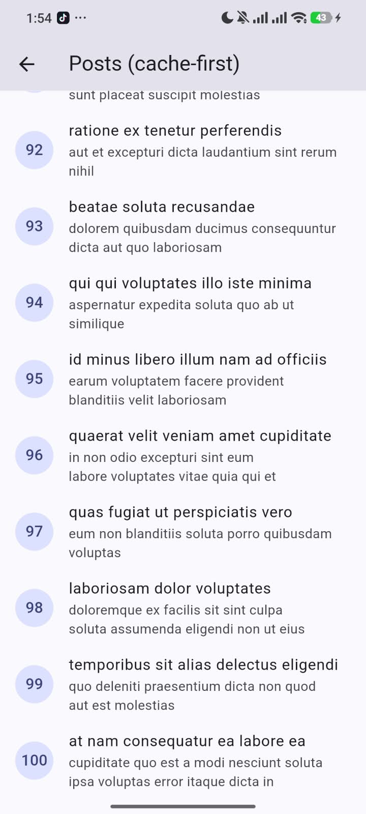

*Gambar 7. Tampilan data posts.*

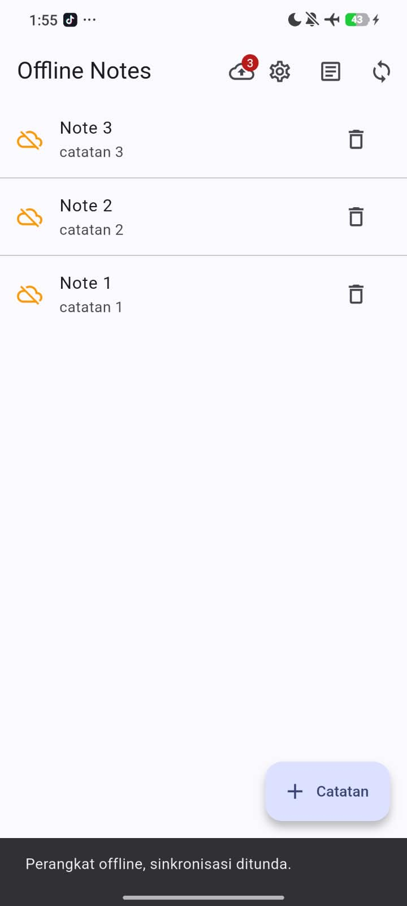

*Gambar 8. Status perubahan sebelum sinkronisasi.*

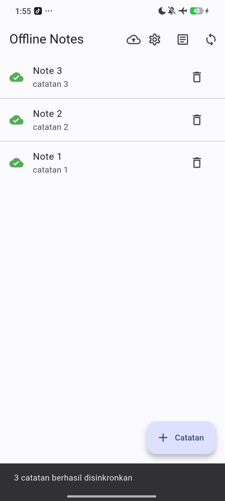

*Gambar 9. Status perubahan sesudah sinkronisasi.*

### Pertanyaan Praktikum 4

**1. Apa perbedaan cache-first dan network-first? Berikan satu contoh data yang lebih cocok memakai network-first.**

**Jawaban:** *Cache-first* mengutamakan data lokal agar cepat diakses dan tersedia saat offline, sedangkan *network-first* mengutamakan data dari server agar informasi yang ditampilkan lebih baru. Contoh data yang lebih cocok menggunakan *network-first* adalah harga saham karena nilainya dapat berubah sewaktu-waktu.

**2. Jelaskan skenario kehilangan data yang dapat terjadi akibat `markAllSynced()`, lalu usulkan perbaikannya.**

**Jawaban:** Kehilangan data dapat terjadi ketika `markAllSynced()` menandai seluruh catatan sebagai tersinkronisasi, padahal beberapa catatan belum berhasil dikirim ke server. Akibatnya, catatan tersebut tidak dikirim kembali karena dianggap sudah tersinkronisasi. Perbaikannya adalah menandai hanya catatan yang berhasil dikirim dan dikonfirmasi oleh server sebagai tersinkronisasi.

**3. Mengapa diperlukan saklar `forceOffline` padahal sudah ada mode pesawat?**

**Jawaban:** Saklar `forceOffline` diperlukan untuk menyimulasikan kondisi offline secara terkontrol tanpa harus memutus koneksi internet perangkat. Saklar ini memudahkan pengujian ketika sinkronisasi harus ditolak, tanpa perlu mengaktifkan atau menonaktifkan mode pesawat berulang kali.

**4. Mengapa `fetchAndCache()` menulis cache di dalam transaksi?**

**Jawaban:** `fetchAndCache()` menggunakan transaksi agar penghapusan cache lama dan penyimpanan data baru berjalan sebagai satu kesatuan. Jika terjadi kegagalan saat menyimpan data, transaksi dapat dibatalkan sehingga cache tidak berada dalam kondisi setengah diperbarui. Penggunaan batch juga dapat membantu mempercepat penyimpanan banyak data ke SQLite.

---

## 9. Praktikum 5 — Pengujian dengan Repository Palsu

### Hasil Screenshot

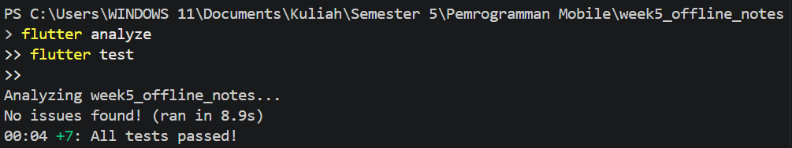

*Gambar 10. Hasil pengujian aplikasi.*

### Pertanyaan Praktikum 5

**1. Mengapa kita menguji provider dengan `ProviderContainer` dan `overrideWithValue`, bukan dengan membuka database asli?**

**Jawaban:** `ProviderContainer` dan `overrideWithValue` memungkinkan provider diuji menggunakan repository palsu tanpa membuka database SQLite asli. Cara ini membuat pengujian lebih cepat, stabil, dan mudah dikontrol karena tidak bergantung pada database maupun emulator.

**2. Apa manfaat parameter `latency` pada `syncNotes` bagi pengujian?**

**Jawaban:** Parameter `latency` mengatur durasi jeda dalam proses sinkronisasi. Saat pengujian, `Duration.zero` dapat digunakan agar test berjalan lebih cepat, sedangkan jeda tertentu dapat digunakan untuk menyimulasikan proses pengiriman data ke server.

**3. Tuliskan satu test tambahan yang menurut Anda penting tetapi belum ada, beserta alasannya.**

**Jawaban:** Test tambahan yang penting adalah menguji fungsi `updateNote()` untuk memastikan bahwa catatan yang diubah memiliki status `dirty = true` dan nilai `updatedAt` diperbarui. Test ini diperlukan agar perubahan catatan dikenali sebagai data yang belum tersinkronisasi dan dimasukkan ke proses sinkronisasi berikutnya.

---

## 10. Tabel Pengujian Praktikum 3 dan 4

### 10.1 Tabel Uji Praktikum 3

| No. | Skenario | Langkah Pengujian | Hasil Aktual | Status |
|---:|---|---|---|---|
| 1 | Empty State | Menjalankan aplikasi ketika belum ada catatan. | Tampilan *empty state* muncul karena belum terdapat catatan. | Lulus |
| 2 | Create | Menekan tombol tambah, mengisi form, lalu menyimpan catatan. | Catatan baru berhasil disimpan dan muncul pada daftar. | Lulus |
| 3 | Validasi | Mencoba menyimpan catatan dengan judul kosong. | Form menolak penyimpanan karena judul belum diisi. | Lulus |
| 4 | Update | Membuka catatan, mengubah isinya, lalu menyimpan perubahan. | Perubahan berhasil disimpan dan ditampilkan pada daftar catatan. | Lulus |
| 5 | Delete | Menekan tombol hapus pada catatan yang dipilih. | Catatan berhasil dihapus dan tidak lagi muncul pada daftar. | Lulus |
| 6 | Persistensi | Menutup aplikasi, kemudian membuka kembali aplikasi. | Catatan tetap tersimpan di database SQLite. | Lulus |
| 7 | Offline | Melakukan operasi CRUD tanpa mengandalkan koneksi internet. | Operasi CRUD tetap dapat dilakukan menggunakan database lokal. | Lulus |

### 10.2 Tabel Uji Praktikum 4

| No. | Skenario | Langkah Pengujian | Hasil Aktual | Status |
|---:|---|---|---|---|
| 1 | Isi Cache | Menghubungkan perangkat ke internet, kemudian membuka halaman Posts. | Data Posts berhasil ditampilkan dan disimpan ke cache lokal. | Lulus |
| 2 | Cache Offline | Membuka halaman Posts setelah cache tersedia dalam kondisi offline. | Data Posts tetap dapat ditampilkan dari cache lokal. | Lulus |
| 3 | Antrean Dirty | Menambahkan tiga catatan baru. | Badge *dirty* menunjukkan catatan yang menunggu proses sinkronisasi. | Lulus |
| 4 | Sync Ditolak | Mengaktifkan saklar *Paksa mode offline*, kemudian menekan tombol Sync. | Sinkronisasi ditolak dan catatan yang belum tersinkronisasi tetap berstatus *dirty*. | Lulus |
| 5 | Sync Berhasil | Menonaktifkan mode offline, kemudian menekan tombol Sync. | Catatan berhasil disinkronisasi dan badge *dirty* menunjukkan tidak ada catatan yang menunggu sinkronisasi. | Lulus |
| 6 | Refresh Background | Membuka halaman Posts saat online ketika cache sudah tersedia. | Cache ditampilkan terlebih dahulu, kemudian data diperbarui dari server. | Lulus |

### 10.3 Tabel Verifikasi Refactoring

| No. | Pengujian | Hasil yang Diharapkan | Status |
|---:|---|---|---|
| 1 | Pemeriksaan kode dengan `flutter analyze` | Tidak ditemukan issue pada kode. | Lulus* |
| 2 | Menjalankan `flutter test` | Seluruh pengujian yang tersedia berhasil. | Lulus* |
| 3 | Membuka halaman detail | Catatan yang dipilih ditampilkan berdasarkan ID. | Lulus* |
| 4 | Memeriksa badge dirty | Badge muncul pada catatan yang belum tersinkronisasi. | Lulus* |
| 5 | Mengubah catatan dari halaman detail | Perubahan tersimpan dan data diperbarui. | Lulus* |

*Keterangan: Status di atas mengikuti narasi laporan bahwa verifikasi telah dilakukan. Pastikan kembali hasil `flutter analyze`, `flutter test`, dan pengujian manual sebelum mengumpulkan laporan.*

---

## 11. AI Prompt Challenge

### 11.1 Prompt yang Digunakan

```text
Aplikasi Flutter Offline Notes memiliki fitur CRUD catatan dan preferensi tema.

Bandingkan SharedPreferences, Hive, sqflite (SQLite), dan Drift
untuk kebutuhan penyimpanan aplikasi tersebut.

Gunakan kriteria:
- Kompleksitas query
- Kebutuhan relasi
- Reaktivitas (stream)
- Type-safety
- Ukuran boilerplate
- Kemudahan testing

Berikan rekomendasi teknologi untuk preferensi dan catatan dalam
satu tabel perbandingan. Tunjukkan rancangan tabel untuk aplikasi
dengan lebih dari 1.000 catatan dan jelaskan trade-off setiap pilihan.
```

### 11.2 Bukti Penggunaan Prompt

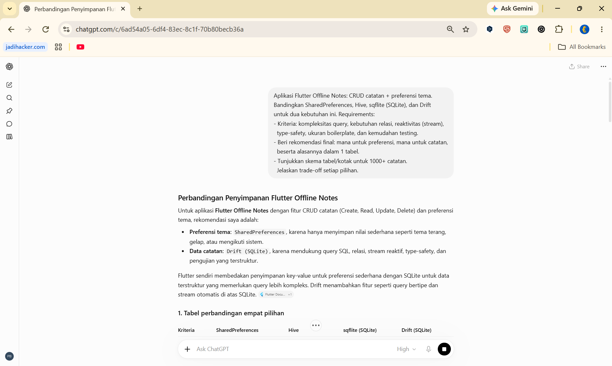

*Gambar 11. Bukti penggunaan prompt AI.*

### 11.3 Ringkasan Rekomendasi AI

Hasil analisis menunjukkan bahwa teknologi penyimpanan perlu dipilih sesuai karakteristik data dan kebutuhan aplikasi.

- **SharedPreferences** sesuai untuk menyimpan preferensi sederhana, seperti tema terang atau gelap.
- **Hive** dapat digunakan untuk menyimpan objek lokal, tetapi pengelolaan query relasional lebih terbatas dibandingkan SQLite.
- **sqflite (SQLite)** mendukung query SQL untuk operasi CRUD, pengurutan catatan, dan pengelolaan status sinkronisasi.
- **Drift** menjadi alternatif ketika aplikasi membutuhkan query reaktif dan type-safety yang lebih kuat, tetapi memerlukan konfigurasi serta *code generation*.

### 11.4 Tabel Perbandingan Teknologi

| Kriteria | SharedPreferences | Hive | sqflite (SQLite) | Drift (SQLite) |
|---|---|---|---|---|
| Kompleksitas query | Sangat sederhana, berbasis key-value | Sederhana, berbasis objek | Mendukung SQL, filter, sorting, dan agregasi | Mendukung query SQL melalui API Dart bertipe |
| Kebutuhan relasi | Tidak mendukung relasi tabel | Relasi perlu dikelola sendiri | Mendukung tabel, foreign key, dan JOIN | Mendukung relasi dan JOIN |
| Reaktivitas | Tidak menyediakan stream query bawaan | Mendukung listener perubahan box | Pembaruan data perlu dikelola melalui mekanisme aplikasi | Mendukung stream perubahan query |
| Type-safety | Terbatas pada tipe nilai preferensi | Model dan adapter dapat digunakan untuk objek | Hasil query umumnya perlu dipetakan ke model Dart | Mendukung query dan model bertipe melalui *code generation* |
| Boilerplate | Sangat sedikit | Memerlukan model atau adapter untuk objek tertentu | Memerlukan SQL dan mapping model | Memerlukan konfigurasi dan *code generation* |
| Kemudahan testing | Cocok untuk preferensi sederhana | Dapat diuji dengan penyimpanan sementara | Dapat diuji dengan database sementara atau repository palsu | Mendukung pengujian dengan database sementara |
| Kesesuaian untuk preferensi | Sangat cocok | Bisa digunakan, tetapi relatif berlebihan | Lebih kompleks dari kebutuhan | Lebih kompleks dari kebutuhan |
| Kesesuaian untuk 1.000+ catatan | Tidak disarankan sebagai penyimpanan utama koleksi catatan | Memungkinkan, tetapi query kompleks perlu pengelolaan tambahan | Cocok untuk CRUD, pencarian, dan pengurutan | Cocok untuk query kompleks dan data reaktif |

### 11.5 Rekomendasi untuk Proyek Week 5

| Kebutuhan | Pilihan | Alasan |
|---|---|---|
| Preferensi tema | **SharedPreferences** | Data tema sederhana dan tidak membutuhkan query kompleks. |
| Catatan lokal | **sqflite (SQLite)** | Sesuai dengan implementasi proyek dan mendukung CRUD, pengurutan, serta status sinkronisasi melalui kolom `dirty`. |
| Alternatif pengembangan lanjutan | Drift | Dapat dipertimbangkan jika dibutuhkan query reaktif dan type-safety yang lebih kuat. |
| Alternatif berbasis objek | Hive | Dapat digunakan untuk penyimpanan objek lokal, tetapi kebutuhan query terstruktur perlu dipertimbangkan. |

**Keputusan akhir:** SharedPreferences digunakan untuk preferensi tema, sedangkan sqflite digunakan untuk catatan. Drift dan Hive berfungsi sebagai pembanding dalam analisis, bukan sebagai teknologi yang diklaim telah diterapkan dalam proyek ini.
## Arsitektur yang Direkomendasikan

``` text
┌─────────────────────────────────────────────┐
│                  Flutter UI                 │
│   Daftar Catatan | Editor | Pengaturan Tema  │
└──────────────────────┬──────────────────────┘
                       │
                       ▼
┌─────────────────────────────────────────────┐
│              Repository / DAO               │
│      CRUD | Pencarian | Filter | Pagination  │
└──────────────────────┬──────────────────────┘
                       │
             ┌─────────┴─────────┐
             ▼                   ▼
┌──────────────────────┐  ┌──────────────────────┐
│     Drift + SQLite   │  │  SharedPreferences   │
│ Tabel catatan/indeks │  │ Preferensi tema lokal│
└──────────────────────┘  └──────────────────────┘
```

Data catatan disimpan dalam database lokal, sedangkan preferensi tema
disimpan secara terpisah. Keduanya dapat digunakan tanpa koneksi
internet.

### 11.6 Rancangan Tabel untuk 1.000+ Catatan

Berikut contoh skema yang sesuai dengan model catatan pada proyek Week 5.

```sql
CREATE TABLE notes (
  id INTEGER PRIMARY KEY AUTOINCREMENT,
  title TEXT NOT NULL,
  body TEXT NOT NULL DEFAULT '',
  updated_at TEXT NOT NULL,
  dirty INTEGER NOT NULL DEFAULT 0
    CHECK (dirty IN (0, 1))
);

CREATE INDEX idx_notes_updated_at
ON notes(updated_at DESC);
```

Keterangan:

- `id`: identitas unik setiap catatan.
- `title`: judul catatan.
- `body`: isi catatan.
- `updated_at`: waktu terakhir catatan diperbarui.
- `dirty`: nilai `1` berarti belum tersinkronisasi, sedangkan `0` berarti sudah tersinkronisasi.

Indeks `idx_notes_updated_at` merupakan saran optimasi untuk query pengurutan. Pastikan indeks tersebut benar-benar diterapkan di database sebelum menyatakan bahwa indeks sudah digunakan.

### 11.7 Trade-off Setiap Pilihan

**SharedPreferences**

- Kelebihan: mudah digunakan dan cocok untuk tema, bahasa, serta pengaturan sederhana.
- Kekurangan: tidak cocok untuk menyimpan koleksi catatan yang membutuhkan query dan relasi.

**Hive**

- Kelebihan: penyimpanan objek lokal relatif sederhana dan mendukung notifikasi perubahan box.
- Kekurangan: query kompleks dan relasi perlu dikelola lebih banyak dibandingkan SQLite.

**sqflite**

- Kelebihan: mendukung SQL, CRUD, transaksi, indeks, dan relasi.
- Kekurangan: mapping hasil query ke model Dart serta pembaruan state UI lebih banyak dikelola secara manual.

**Drift**

- Kelebihan: mendukung query bertipe, stream reaktif, dan pengelolaan skema yang terstruktur.
- Kekurangan: membutuhkan konfigurasi awal dan *code generation*.

### 11.8 Kesimpulan AI Prompt Challenge

Perbandingan menunjukkan bahwa tidak ada satu teknologi yang paling sesuai untuk semua jenis data. SharedPreferences paling tepat untuk preferensi sederhana, sedangkan database SQLite lebih sesuai untuk data catatan yang memerlukan CRUD dan pengurutan. Drift dapat menjadi alternatif jika kebutuhan reaktivitas dan type-safety meningkat. Untuk proyek Week 5, sqflite dipertahankan karena sesuai dengan implementasi yang digunakan dan kebutuhan praktikum.

Dokumentasi pendukung: `docs/ai-challenge.md` dan `docs/perbandingan-storage.md`.

---

## 12. Refactoring Challenge

### 12.1 Tujuan Refactoring

Refactoring dilakukan untuk memperbaiki struktur kode aplikasi Offline Notes agar lebih rapi, mudah dipahami, dan mudah dikembangkan. Perubahan yang dibahas meliputi pemisahan widget catatan, pemisahan tanggung jawab repository dan logika sinkronisasi, serta navigasi menuju halaman detail menggunakan GoRouter.

### 12.2 Ekstraksi Widget `NoteTile`

Komponen tampilan catatan dipisahkan ke dalam file `lib/widgets/note_tile.dart`. Widget ini menerima objek `Note`, fungsi `onTap`, dan fungsi `onDelete` sebagai parameter. Informasi yang ditampilkan meliputi judul, isi catatan, status sinkronisasi, dan badge **“Belum tersinkron”** ketika `note.dirty` bernilai `true`.

Pemisahan ini membuat `NotesPage` lebih sederhana dan memungkinkan tampilan setiap catatan digunakan kembali.

### 12.3 Pemisahan Tanggung Jawab Repository

| File | Tanggung Jawab |
|---|---|
| `lib/data/repositories/note_repository.dart` | Mengelola CRUD catatan, menghitung catatan yang belum tersinkronisasi, dan memperbarui status sinkronisasi. |
| `lib/data/repositories/post_repository.dart` | Mengelola pengambilan data posts dan cache lokal. |
| `lib/data/sync.dart` | Mengelola proses `syncNotes()`, penanganan kondisi offline, dan penyelesaian konflik data. |

Pemisahan ini menjaga agar pengelolaan catatan, cache posts, dan sinkronisasi memiliki tanggung jawab yang jelas.

### 12.4 Halaman Detail Menggunakan GoRouter

GoRouter digunakan untuk mengatur rute halaman detail melalui pola `/note/:id`. Provider `noteByIdProvider` mengambil catatan berdasarkan ID melalui `NoteRepository.getNoteById()`. Halaman detail dapat menampilkan judul, isi, waktu pembaruan, status sinkronisasi, dan tombol untuk mengubah catatan.

Konfigurasi navigasi dilakukan melalui `MaterialApp.router`, sedangkan pemilihan catatan dilakukan melalui widget `NoteTile`.

### 12.5 Verifikasi Refactoring

Perintah berikut digunakan untuk memeriksa dan menguji proyek:

```bash
flutter pub get
dart format lib test
flutter analyze
flutter test
```

Pengujian manual juga diperlukan untuk memastikan navigasi halaman detail, tampilan badge sinkronisasi, dan operasi CRUD berjalan sesuai fungsinya.

| No. | Pengujian | Hasil yang Diharapkan | Status |
|---:|---|---|---|
| 1 | Pemeriksaan kode dengan `flutter analyze` | Tidak ditemukan issue pada kode. | Lulus* |
| 2 | Menjalankan `flutter test` | Seluruh pengujian yang tersedia berhasil. | Lulus* |
| 3 | Membuka halaman detail | Catatan yang dipilih ditampilkan berdasarkan ID. | Lulus* |
| 4 | Memeriksa badge dirty | Badge muncul pada catatan yang belum tersinkronisasi. | Lulus* |
| 5 | Mengubah catatan dari halaman detail | Perubahan tersimpan dan data diperbarui. | Lulus* |

*Keterangan: Status mengikuti narasi laporan bahwa verifikasi telah dilakukan. Periksa kembali hasil aktual sebelum mengumpulkan laporan.*

### 12.6 Contoh Commit Refactoring

Jalankan commit setelah file terkait benar-benar diubah dan pengujian yang diperlukan dilakukan.

```bash
git add lib/widgets/note_tile.dart lib/pages/notes_page.dart
git commit -m "refactor(notes): extract NoteTile widget"
```

```bash
git add lib/data/repositories/note_repository.dart lib/data/repositories/post_repository.dart lib/data/sync.dart
git commit -m "refactor(data): separate repository and sync responsibilities"
```

```bash
git add lib/app_router.dart lib/pages/note_detail_page.dart lib/providers/note_providers.dart lib/main.dart
git commit -m "feat(notes): add GoRouter note detail page"
```

### 12.7 Kesimpulan Refactoring

Refactoring membantu meningkatkan keterbacaan dan pemeliharaan kode melalui pemisahan widget, repository, dan logika sinkronisasi. Navigasi dengan GoRouter juga membuat pengelolaan halaman detail lebih terstruktur. Hasil akhirnya tetap perlu diverifikasi melalui analisis kode, pengujian otomatis, dan pengujian manual.

---

## 13. Pertanyaan Refleksi

### 1. Mengapa daftar catatan tidak boleh disimpan di SharedPreferences? Apa yang rusak jika aturan ini dilanggar?

**Jawaban:** Menurut saya, SharedPreferences lebih cocok untuk menyimpan data sederhana, seperti tema aplikasi dan waktu terakhir dibuka. Jika digunakan untuk menyimpan banyak catatan, proses pencarian, pengubahan, dan penghapusan data menjadi kurang praktis karena SharedPreferences tidak dirancang untuk mengelola data seperti database. Oleh karena itu, SQLite lebih tepat digunakan karena mendukung CRUD dan pengurutan catatan dengan lebih terstruktur.

### 2. Kapan cache-first cukup, dan kapan Anda membutuhkan strategi lain, misalnya network-first untuk data harga real-time?

**Jawaban:** *Cache-first* cukup untuk data yang tidak sering berubah dan masih berguna ketika internet tidak tersedia, seperti daftar posts. Namun, untuk data yang membutuhkan informasi terbaru, seperti harga saham, *network-first* lebih sesuai karena aplikasi akan mencoba mengambil data langsung dari server. Pemilihan strategi harus disesuaikan dengan kebutuhan data dan seberapa penting informasi terbaru bagi pengguna.

### 3. Bagaimana dirty flag berubah menjadi antrean sync tanpa memblokir UI? Kapan antrean terpisah (tabel outbox) menjadi perlu?

**Jawaban:** Ketika pengguna menambah atau mengubah catatan, aplikasi menyimpan perubahan ke SQLite dan memberikan status `dirty = true` sebagai tanda bahwa data belum tersinkronisasi. Proses sinkronisasi dapat berjalan secara asynchronous sehingga pengguna tetap bisa menggunakan aplikasi tanpa harus menunggu proses tersebut selesai. Jika pengiriman berhasil, status `dirty` diubah menjadi `false`. Tabel outbox dapat diperlukan ketika aplikasi memiliki banyak perubahan yang harus dikirim secara berurutan, membutuhkan mekanisme percobaan ulang, atau harus memastikan setiap perubahan tetap tercatat meskipun koneksi internet terputus.

### 4. Bagian mana dari rekomendasi AI yang Anda tolak, dan mengapa?

**Jawaban:** Saya tidak selalu memilih teknologi yang memiliki fitur paling lengkap karena kebutuhan aplikasi juga perlu dipertimbangkan. Drift menawarkan query reaktif dan type-safety yang lebih kuat, tetapi saya memilih SQLite melalui `sqflite` karena sudah memenuhi kebutuhan CRUD, pengurutan catatan, dan pengelolaan status sinkronisasi. Penggunaan Drift akan menambah kompleksitas yang belum terlalu diperlukan dalam praktikum ini. Oleh karena itu, rekomendasi AI digunakan sebagai bahan pertimbangan, sedangkan keputusan akhir disesuaikan dengan kebutuhan dan implementasi proyek.

---

## 14. Kesimpulan Praktikum Minggu 5

Praktikum Minggu 5 memberikan pemahaman mengenai pentingnya penyimpanan data lokal dan penerapan pendekatan *offline-first* pada aplikasi Flutter. SharedPreferences digunakan untuk menyimpan preferensi sederhana, sedangkan SQLite melalui `sqflite` digunakan untuk menyimpan catatan agar data tetap tersedia meskipun aplikasi ditutup atau perangkat tidak terhubung ke internet. Riverpod membantu mengelola state aplikasi sehingga perubahan data dapat ditampilkan kembali melalui provider yang sesuai.

Pada praktikum berikutnya, mekanisme *cache-first* dan sinkronisasi memperlihatkan bahwa aplikasi dapat menampilkan data cache ketika offline serta memperbarui data ketika koneksi tersedia. Penggunaan status `dirty` membantu mengenali catatan yang belum tersinkronisasi, sedangkan pengujian dengan `ProviderContainer` dan repository palsu memudahkan pemeriksaan perilaku provider dan logika sinkronisasi tanpa selalu menggunakan database asli.

AI Prompt Challenge membantu membandingkan teknologi penyimpanan berdasarkan kebutuhan aplikasi, sedangkan Refactoring Challenge menekankan pentingnya pemisahan widget, repository, dan logika sinkronisasi. Secara keseluruhan, praktikum ini menunjukkan bahwa aplikasi mobile yang baik tidak hanya perlu memiliki fitur yang berjalan, tetapi juga membutuhkan pengelolaan data yang konsisten, pengujian yang memadai, dan struktur kode yang mudah dipelihara. Hasil implementasi tetap perlu diperiksa dengan menjalankan aplikasi dan seluruh pengujian sebelum laporan dikumpulkan.

